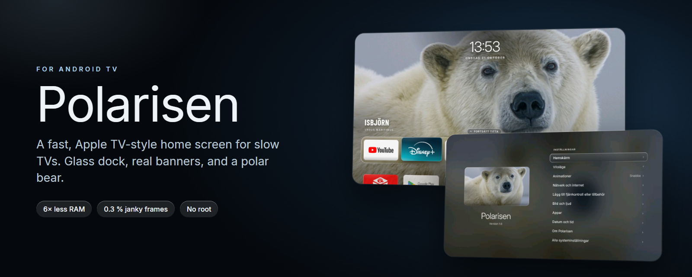
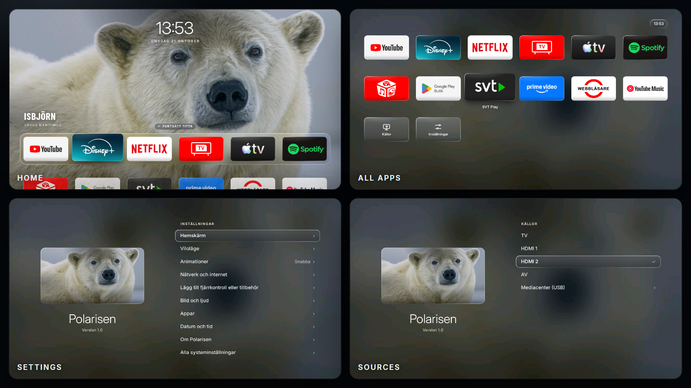

<p align="center"></p>

<p align="center">
<a href="../../releases/latest"></a>


<a href="LICENSE"></a>
</p>

<h3 align="center">Is your smart TV slow and cluttered? Give it a home screen that feels like an Apple TV.</h3>

A fast, Apple TV-inspired home screen, screensaver and settings app for **low-memory Android TVs**, with a polar bear and winter-nature theme. Built and tuned on a **TCL 40ES565** (Android 9, 1.4 GB RAM, no root), where the stock launcher used 170 MB of RAM and dropped over a third of its frames.

*[Svensk sammanfattning längst ned.](#svenska)*

| | Stock Google TV launcher | Polarisen |
|---|---|---|
| Home screen memory | 159–177 MB | ~28–40 MB |
| Janky frames while browsing | 34–39 %, worst frames 550 ms | 0.3 %, 8–10 ms per frame |
| Cold start | – | ~0.6 s |

<p align="center"></p>

## What you get

- **Home screen** like tvOS: a glass dock with your 6 favourite apps, all apps in a 6-column grid below, real app banners, focus lift and a blurred backdrop when you scroll down. Hold OK on an app to rearrange.
- **Continue watching** row (press Up): what you last played in Netflix, YouTube, SVT Play, Spotify and so on. Selecting it opens the app and presses play.
- **Rotating pictures**: a polar bear first, then winter photos with a slow cross-fade (interval is a setting).
- **Screensaver** with the same pictures, a clock and a slow zoom.
- **Settings** in the same style: sleep and auto-off timers, animation speed, picture interval, intro on/off, source picker (HDMI/AV/TV), "About" with real device info. System pages Polarisen can't restyle (network, picture & sound, apps) are one click away.
- **Reversible debloat lists** for TCL TVs (telemetry, ads, voice assistant, the stock launcher) that you can apply and undo.

## Will it work on my TV?

Tested only on the TCL 40ES565 (Realtek RTD2841, Android 9). It should install on any Android TV with Android 9 (API 28) or newer, but I can't promise anything: the source/settings pages and the debloat lists use **TCL-specific** components, and other brands will need their own lists. Do the "Try it first" step below before changing anything permanent.

## Install (about 5 minutes, no root)

1. On the TV: Settings → About → press *Build* 7 times, then Developer options → turn on **USB debugging / Network debugging**. Note the TV's IP address (Settings → Network).
2. On your computer, install [adb (platform-tools)](https://developer.android.com/tools/releases/platform-tools) and put it in your PATH.
3. Download `polarisen.apk` and the scripts from the [latest release](../../releases/latest) (or clone this repo and use the APK in the release).
4. Run the installer and accept the "Allow debugging" prompt on the TV:
   - Windows: `powershell -ExecutionPolicy Bypass -File install.ps1 -Ip 192.168.0.50`
   - macOS/Linux: `./install.sh 192.168.0.50`

The installer installs the app and grants three permissions over adb: `DUMP` (reads which media is playing, for "Continue watching"), `WRITE_SECURE_SETTINGS` and `WRITE_SETTINGS` (so the settings pages can change sleep timers and animation speed). Without them everything still works except those features.

### Try it first

Open **Polarisen** from the app list. Nothing else has changed; press Home and your normal launcher is still the default.

### Make it your home screen (optional)

On Android TV the stock launcher outranks any other home app, so the Home button keeps opening it. To switch:

```
adb shell cmd package set-home-activity se.isbjorn.home/.HomeActivity
adb shell pm disable-user --user 0 com.google.android.tvlauncher     # the stock launcher
```

Both are reversible (`pm enable ...`). Only do this once Polarisen works for you. The scripts in `scripts/` automate this and log every change so `restore.ps1` can undo it; see below.

### Optional debloat (TCL TVs)

`debloat/batch1.txt` disables telemetry/ad/extra apps, `debloat/batch2.txt` disables the voice assistant, stock launcher and OTA services. Run `scripts\debloat.ps1 -File debloat\batch1.txt -DryRun` first to see what would happen. Everything uses `pm disable-user` / settings, nothing outside `/data` is touched, so **a factory reset always restores the original system**. `scripts\restore.ps1` reverts everything from `changes.log`.

## Uninstall

`powershell -ExecutionPolicy Bypass -File uninstall.ps1 -Ip <tv-ip>` re-enables what the lists disabled, restores the screensaver and removes the app.

## Why it is fast

Android 9 TVs have weak GPUs and little RAM, so the launcher avoids everything that costs frames: no AndroidX/Compose, no live blur (the glass and blur are **pre-baked into the pictures** by `images/tools/glass.ps1`), no elevation shadows (one pre-blurred shadow bitmap), no animated text shadows, a pre-rendered scrim, and static layers drawn from a cached bitmap. Measuring with `dumpsys gfxinfo` found each of these. Details are in the commit history.

## Build from source

JDK 17 and the Android SDK (platform 34, build-tools 34). `cd launcher && ./gradlew assembleRelease` → `launcher/app/build/outputs/apk/release/app-release.apk` (signed with the debug key; fine for sideloading). To use your own first picture (the first one on every start), replace `bg_00.jpg`, `dock_00.jpg` and `grid_00.jpg` in `launcher/app/src/main/res/drawable-nodpi/`: put a 16:9 picture in `images/prepared/` as `bg_00.jpg` and run `images/tools/glass.ps1` (PowerShell, Windows).

## Limits

- Android's own screens (network, apps, "About Android") and TCL's picture/sound panel are system apps and can't be restyled without root. Rooting is **not** recommended: locked bootloader, streaming-app DRM, and it breaks the factory-reset guarantee.
- The "Continue watching" row reads `dumpsys media_session` (Android 9 blocks apps from Google's own list), so it only shows what was playing since Polarisen was installed.
- Use at your own risk, no warranty. Not affiliated with TCL, Google, Apple or Netflix; all names belong to their owners.

## Credits

Photos: Unsplash contributors, see [`images/LICENSES.md`](images/LICENSES.md). Fonts: Inter and Barlow Condensed (SIL OFL). Licensed under the [MIT License](LICENSE).

---

## Svenska

**Polarisen** är en snabb hemskärm, skärmsläckare och inställningsapp i Apple TV-stil för Android-TV med lite minne, med isbjörn och vinternatur som tema. Byggd och trimmad på en TCL 40ES565 (Android 9, ingen root). Den använder ~30 MB RAM mot Googles 170 MB och hackar nästan inte alls.

**Installera:** slå på nätverksfelsökning i TV:ns utvecklaralternativ, installera adb på datorn, hämta `polarisen.apk` och skripten från [senaste releasen](../../releases/latest) och kör `install.ps1 -Ip <TV:ns IP>` (Windows) eller `./install.sh <IP>` (Mac/Linux). Öppna sedan **Polarisen** i applistan. Vill du ha den som hemskärm, följ avsnittet *Make it your home screen* ovan. Allt går att ångra, och en fabriksåterställning ger alltid originalet. Testat bara på TCL 40ES565, så prova först innan du ändrar något permanent. Använd på egen risk.